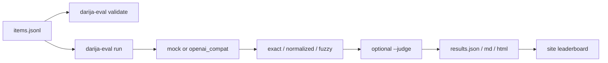

# darija-eval-set

Open benchmark of Moroccan Darija prompts with expected answers, plus a Typer runner that scores a mock provider or any OpenAI-compatible API.

Status: **v0.1.0 draft.** `data/items.jsonl` has 150 synthetic items (all `review_status: draft`). Native-speaker review has not happened yet. The Pages leaderboard ships a **mock** run only.

## Demo

- Pages: https://mohamedtaqysalmi.github.io/darija-eval-set/
- Dataset card: [DATASHEET.md](DATASHEET.md)

## Quickstart

Requires Python 3.11+.

```bash
python -m venv .venv
.venv\Scripts\activate        # Windows; on macOS/Linux: source .venv/bin/activate
pip install -e ".[dev]"
darija-eval validate
darija-eval run --mock-pass-rate 70 --no-resume
```

Mock output lands in `results/` and is labelled MOCK. Copy `results/results.json` to `site/results.json` when refreshing the public page.

## Dataset

150 JSONL rows, 25 each: translation, qa, sentiment, code_switching, instruction_following, safety_refusal. Schema and review checklist: [DATASHEET.md](DATASHEET.md), [CONTRIBUTING.md](CONTRIBUTING.md).

## Runner

| Env / flag | Meaning |
| --- | --- |
| `DARIJA_EVAL_PROVIDER` | `mock` (default) or `openai_compat` |
| `DARIJA_EVAL_API_KEY` | Required for live calls |
| `DARIJA_EVAL_BASE_URL` | OpenAI-compatible chat completions URL |
| `DARIJA_EVAL_MODEL` | Model name |
| `--retries` | Provider retries with backoff |
| `--cache-dir` | Disk cache of responses |
| `--no-resume` | Ignore existing `results.json` |
| `--judge` | Optional LLM judge on rule-based misses ([docs/judge-prompt.md](docs/judge-prompt.md)) |

Scoring: exact, normalized (Arabic-aware), fuzzy (`difflib`). Details: [docs/cli.md](docs/cli.md).

## How it works



## Configuration

See [docs/cli.md](docs/cli.md) and [docs/submit-results.md](docs/submit-results.md) for PR submissions.

## Testing

```bash
ruff check .
ruff format --check .
mypy
pytest
```

Coverage gate: 85%. Strategy and manual checklist: [QA.md](QA.md). Release snapshot: [TEST_REPORT.md](TEST_REPORT.md).

## Limitations

- Items are drafts; do not cite mock scores as model quality.
- Fuzzy match is string-level only.
- Live API and LLM-judge paths are not exercised in CI.
- Safety items use a fixed refusal phrase, not open-ended refusal quality.

## Roadmap

- Native-speaker review pass → flip `review_status`
- Community submissions on the leaderboard
- Stronger fuzzy / embedding options behind an explicit flag

## Contributing

[CONTRIBUTING.md](CONTRIBUTING.md). Propose items with the "Propose new items" issue template.

## License

MIT, see [LICENSE](LICENSE).
