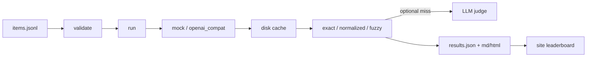

# Architecture

Short decisions for v0.1.0.

## ADR-001: JSONL + Pydantic in CI

**Decision.** Items live in `data/items.jsonl`. `darija-eval validate` (and CI) parse every line with the Pydantic `Item` model and reject duplicates or schema drift.

**Why.** Contributors can edit one line at a time; malformed rows fail the build before they hit a run.

**Trade-off.** Large refactors across all items are noisy diffs. A future bulk editor can help.

## ADR-002: Mock provider is the default

**Decision.** `DARIJA_EVAL_PROVIDER` defaults to `mock`. The mock returns the first expected answer for a stable hash bucket of ids and a fixed wrong string otherwise.

**Why.** Clone-and-run without API keys. Public Pages numbers are labelled mock so they cannot be mistaken for a model leaderboard.

**Trade-off.** Mock accuracy is an artifact of the hash, not linguistic quality.

## ADR-003: Disk cache + resumable results.json

**Decision.** Responses cache under `.cache/darija-eval/` keyed by provider, model and prompt. `run` writes `results.json` after each new item and skips ids already present unless `--no-resume`.

**Why.** Flaky networks and long suites should not redo finished work.

**Trade-off.** Cache keys are provider, model and prompt only, so editing a prompt's expected answers does not invalidate them (scoring is redone on every run, so this only matters for the response text). The mock provider is never cached: its answer depends on the item id and pass rate, not just the prompt. Resume reuses a row only when the earlier `results.json` has the same provider, model and dataset path and the item's scoring and expected answers are unchanged.

## ADR-004: Rule scoring first, optional judge

**Decision.** Exact / normalized / fuzzy are the default path. `--judge` may rescue misses only; see `docs/judge-prompt.md`.

**Why.** Interview demos stay offline; judge cost and variance stay opt-in.

## Pipeline

